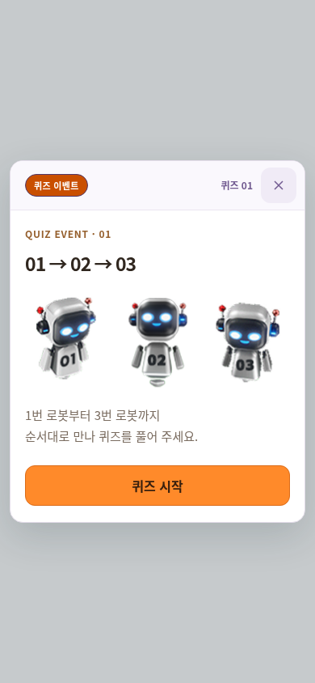

# 퀴즈 이벤트 v2.1 — 기존 로봇 예시 추가

[전체 ZIP 다운로드](https://github.com/junho3789/ZEP/raw/refs/heads/downloads/chonnam-quiz02-updated/dist/chonnam-quiz-event-v2.1.zip)

퀴즈 1의 ‘01 → 02 → 03’ 순서 안내 화면에 기존 원본의 로봇 3종을 추가했습니다. 원본 이미지는 바꾸지 않고 일러스트 영역을 표시합니다. 이미지가 HTML에 포함되어 추가 리소스 파일이 필요하지 않습니다.

v2에서 변경된 파일은 res/pc_Quiz1.html 한 개입니다. v2를 이미 사용 중이면 이 HTML만 교체하면 됩니다. 처음 적용하는 경우에는 전체 ZIP을 사용하세요. 기존 문항·엑셀 수정·스탬프 게이지·미션 안내와 저장 로직은 유지했습니다.

PC/모바일 7가지 화면 크기에서 이미지 로딩, 기본 UI를 위한 여백, 내부 스크롤, 퀴즈 시작과 채점을 검증했습니다. ZIP 무결성과 다른 파일·퀴즈 스크립트 유지도 확인했습니다.

[v2 상세 적용 안내](chonnam-quiz-event-v2.md)
