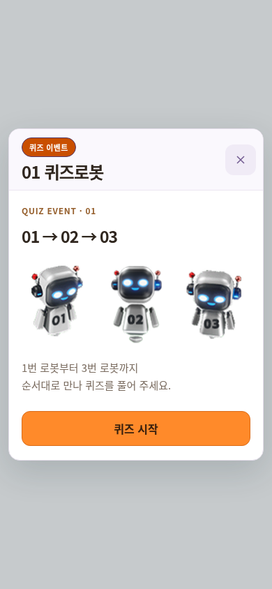

# 퀴즈 이벤트 v2.2 — 로봇 제목 강조

[전체 ZIP 다운로드](https://github.com/junho3789/ZEP/raw/refs/heads/downloads/chonnam-quiz02-updated/dist/chonnam-quiz-event-v2.2.zip)

각 로봇의 시작 안내·문제·정답/오답·완료 화면 상단에 ‘01 퀴즈로봇’, ‘02 퀴즈로봇’, ‘03 퀴즈로봇’을 큰 제목으로 표시합니다. 데스크톱 26px, 모바일 24px, 높이가 낮은 가로 화면 22px로 표시하며 본문 스크롤 중에도 헤더에 남습니다.

v2.1 대비 res/pc_Quiz1.html, res/pc_Quiz2.html, res/pc_Quiz3.html만 변경했습니다. 기존 v2/v2.1을 사용 중이면 세 HTML만 교체해도 적용됩니다. 원본 로봇 이미지와 기존 문항 수정, 스탬프 게이지, 미션 안내, 채점·저장 로직을 유지했습니다. 에너지AI 로봇 문제의 원인은 해당 맵의 앱 미설정으로 확인되어 별도 코드 변경은 하지 않았습니다.

7가지 화면 크기에서 퀴즈 화면/흐름 133개 상태와 모든 quiz02 문항 표시를 확인했습니다. 세 로봇 제목의 표시, 글자 크기와 닫기 버튼 간격도 추가 확인했습니다. ZIP 무결성과 변경 범위, 기존 JavaScript 유지 검증을 통과했습니다.

