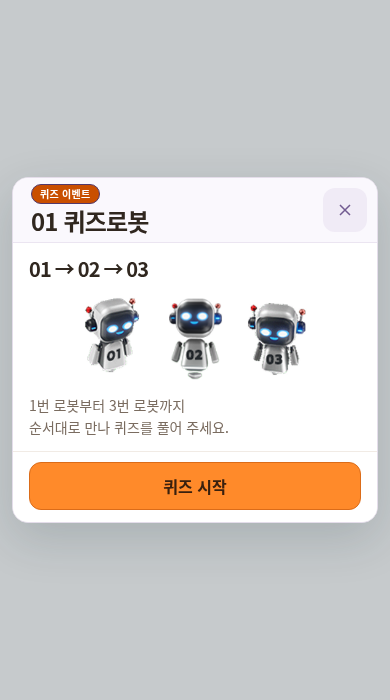

# 퀴즈 이벤트 v2.5 — 모바일 진행 버튼 표시 개선

[통합 ZIP 다운로드](https://github.com/junho3789/ZEP/raw/refs/heads/downloads/chonnam-quiz02-updated/dist/chonnam-quiz-event-v2.5.zip)

퀴즈 시작 버튼이 모바일에서 내용 스크롤 아래로 가려지는 문제를 수정했습니다. 시작·다음·확인·다시 풀기 버튼을 내용 영역 밖의 고정 하단 영역에 배치했습니다. 미션 안내의 확인 버튼도 같은 방식입니다. 내용이 길거나 화면 높이가 낮아도 진행 버튼은 보이며, 내용만 스크롤합니다.

모바일에서는 헤더와 상하 여백, 로봇 이미지 크기와 줄 간격을 줄였습니다. 로봇 제목과 예시 이미지는 유지합니다. 320×568, 390×700 화면에서 로봇 순서 안내의 이미지·전체 문구·시작 버튼을 스크롤 없이 확인했습니다. 상단 ZEP UI와 하단 채팅을 위한 기존 여백은 유지했습니다.

낮은 가로 화면에서는 헤더의 작은 이벤트 배지를 숨기고 로봇 제목과 닫기 버튼을 남깁니다. 아주 긴 내용은 내부 스크롤로 읽을 수 있으며 버튼 영역과 겹치지 않습니다.

## 적용

v2.4 대비 다음 네 HTML만 변경했습니다. 기존 v2.4를 사용 중이면 이 파일들을 같은 경로로 교체하면 됩니다.

- res/pc_Quiz1.html
- res/pc_Quiz2.html
- res/pc_Quiz3.html
- res/mission_notice.html

통합 ZIP에는 관리자 초기화 명령어, #8AFF00 스탬프 체크·게이지, 로봇 이미지, 큰 로봇 제목과 엑셀 문항 수정을 모두 포함합니다. main.js와 기존 JavaScript는 변경하지 않았습니다.

## 검증

7가지 화면 크기의 133개 화면/퀴즈 흐름 검사와 quiz02 39개 문항 표시, 미션 안내 검사를 통과했습니다. 진행 버튼이 스크롤 전에도 보이고 다른 요소에 가려지지 않으며 터치 가능한지 확인했습니다. 모바일 세로 화면의 시작·안내·결과 화면은 본문 스크롤이 필요 없는지도 확인했습니다. ZIP 무결성과 변경 파일 범위, 모든 기존 스크립트 유지도 검사했습니다. 실제 ZEP 앱 서버 테스트는 포함하지 않습니다.

