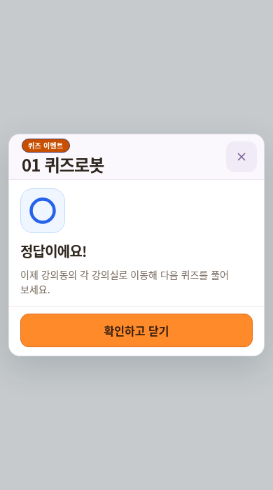
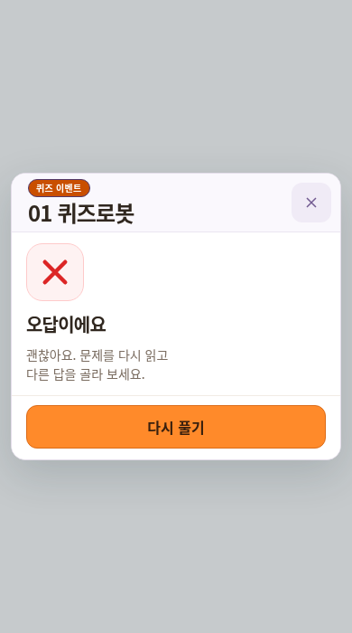

# 퀴즈 이벤트 v2.6 — 정답 O / 오답 X

[통합 ZIP 다운로드](https://github.com/junho3789/ZEP/raw/refs/heads/downloads/chonnam-quiz02-updated/dist/chonnam-quiz-event-v2.6.zip)

퀴즈 1·2·3의 정답 결과는 큰 파란색 O(#2563EB), 오답 결과는 큰 빨간색 X(#DC2626)로 표시합니다. 결과 제목도 ‘정답이에요!’, ‘오답이에요’로 명확하게 구분합니다. 기존 안내 문구, 재시도·확인 버튼과 채점 로직은 유지했습니다. 전체 퀴즈 완료 화면도 파란 O 표시를 사용합니다.

색뿐 아니라 O/X 형태와 설명 텍스트로 구분하며, SVG를 사용해 기기별 글꼴 차이 없이 같은 형태로 표시합니다. 모바일에서도 결과와 고정 하단 버튼이 함께 보이도록 확인했습니다.

## 적용

v2.5 대비 변경 파일은 다음 세 개입니다. 기존 v2.5 사용 시 같은 경로의 HTML을 교체하면 됩니다.

- res/pc_Quiz1.html
- res/pc_Quiz2.html
- res/pc_Quiz3.html

main.js와 채점·저장 스크립트는 바꾸지 않았습니다. 관리자 초기화 명령어, #8AFF00 스탬프·게이지, 큰 로봇 제목, 원본 로봇 이미지, 엑셀 수정 및 모바일 진행 버튼 개선을 모두 포함한 전체 앱 ZIP입니다.

## 검증

7가지 화면 크기의 기존 133개 화면/흐름 검사 및 quiz02 39개 문항 표시 검사를 통과했습니다. 세 퀴즈의 모바일/PC 결과 18개 상태에서 파란 O·빨간 X, 결과 문구, 재시도, 마지막 정답·전체 완료, 하단 버튼 표시를 추가 확인했습니다. ZIP 무결성과 변경 파일 범위, 기존 JavaScript 유지도 검사했습니다. 실제 ZEP 서버에서의 실행 검증은 포함하지 않습니다.

