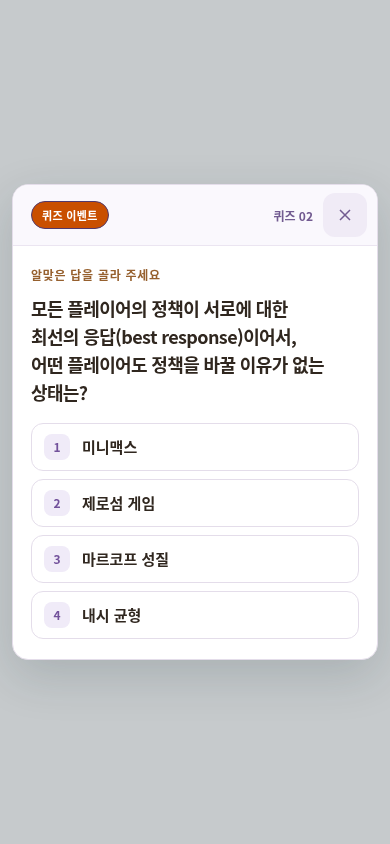
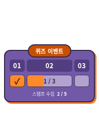
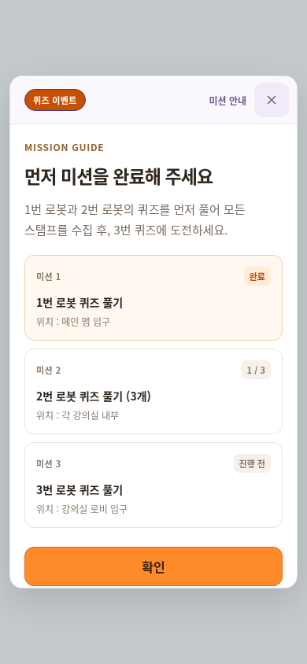

# 전남대 퀴즈 이벤트 v2

[통합 ZIP 다운로드](https://github.com/junho3789/ZEP/raw/refs/heads/downloads/chonnam-quiz02-updated/dist/chonnam-quiz-event-v2.zip)

## 화면과 스탬프

- 퀴즈 시작·문제·정답·오답·완료·미션 안내를 같은 주황색/보라색 테마로 통일했습니다.
- 흰 카드, 공통 헤더, 44px 이상의 조작 영역과 카드 내부 스크롤을 사용합니다.
- 상단 ZEP UI와 하단 채팅 영역을 위해 각각 96px의 여백을 확보합니다. 높이 420px 이하의 가로 화면에서는 상단 80px, 하단 72px을 확보합니다. 안전 영역 여백도 추가됩니다.
- 스탬프 창은 기존 주황 배지·보라색 본체를 살렸습니다. 제목은 “퀴즈 이벤트”, 큰 숫자는 “01 · 02 · 03”입니다.
- 01·03은 독립 수집 칸입니다. 02는 스탬프 2·3·4를 합친 하나의 주황색 게이지이며 0/3 → 1/3 → 2/3 → 3/3으로 차오릅니다. 전체 수집 수도 별도 표시합니다.
- 퀴즈 또는 미션 안내가 열려 있을 때 스탬프 위젯을 제거하고, 닫히면 최신 저장 상태로 다시 표시합니다. 취소하거나 오답으로 닫아도 다시 표시합니다.
- 처음부터 모든 스탬프가 수집된 것처럼 표시되던 모바일 초기 상태를 수정했습니다.

## 선행 미션 안내

1·2번 퀴즈를 완료하기 전에 3번 로봇에 접근하면 아래 문구와 미션별 완료 상태를 팝업으로 표시합니다.

> 1번 로봇과 2번 로봇의 퀴즈를 먼저 풀어 모든 스탬프를 수집 후, 3번 퀴즈에 도전하세요.

| 미션 | 내용 | 위치 |
| --- | --- | --- |
| 1 | 1번 로봇 퀴즈 풀기 | 메인 맵 입구 |
| 2 | 2번 로봇 퀴즈 풀기 (3개) | 각 강의실 내부 |
| 3 | 3번 로봇 퀴즈 풀기 | 강의실 로비 입구 |

1번 미완료 상태에서 2번 로봇에 접근해도 같은 디자인의 안내가 나옵니다.

## 엑셀 수정 반영

첨부한 “AICOSS 강좌 및 퀴즈 목록(수정요청).xlsx”와 대조했습니다.

| quiz02 번호 | 과목 | 수정 |
| --- | --- | --- |
| 4 | 인공지능기초와활용V2 | 문제·선택지 교체. 정답: 2번 K-Means Clustering |
| 5 | 데이터분석기초 | 문제·선택지 교체. 정답: 1번 데이터 |
| 22 | 첨단심층신경망 | 정답: 3번 근사화 |
| 29 | 자료구조와알고리즘1 | Big-Thetas → Big-Theta |

기존에 수정한 14번(내시 균형), 33번(이산 자료)은 유지했습니다. 엑셀에 문제·선택지·정답이 있는 32개 행은 모두 일치합니다. 빈 문항 행은 기존 내용을 유지했습니다.

## 에너지AI 로봇 퀴즈 연결

에너지AI는 quiz02의 37번 문항입니다. 코드에서 번호, 앞뒤 공백, “37번”, “quiz37”, “에너지AI”, “에너지 AI”를 모두 37번으로 해석하도록 보완했습니다. 상호작용 키의 대소문자와 앞뒤 공백도 처리합니다. 잘못된 문항 값은 엉뚱한 문제를 열지 않고 안내 창을 표시합니다.

ZIP에는 ZEP 맵 오브젝트 설정이 들어 있지 않습니다. 실제 로봇이 이 스크립트의 상호작용 이벤트를 보내는지는 맵에서 확인해야 합니다. 이 앱이 받는 표준 설정값은 다음과 같습니다.

- 상호작용 유형: ZEP Script와 상호작용
- 키 값(param1): Quiz02
- 텍스트(text): 37 또는 에너지AI

정상 값과 강좌명으로 37번 문항을 여는 코드 경로는 테스트했습니다. 맵에 상호작용 자체가 연결되지 않은 경우에는 맵 설정도 수정해야 합니다.

## 적용 파일

이번에는 HTML만 교체하면 스탬프 숨김·복원과 로봇 연결 처리가 적용되지 않습니다. main.js도 함께 업데이트하세요.

- main.js
- res/pc_Quiz1.html
- res/pc_Quiz2.html
- res/pc_Quiz3.html
- res/pc_stamp.html
- res/m_stamp.html
- res/mission_notice.html (추가)

ZIP은 기존 앱 구조를 유지한 전체 앱입니다. 다른 리소스는 그대로 유지했습니다.

## 검증

Chromium의 1440×900, 768×1024, 390×844, 360×640, 320×568, 844×390, 568×280에서 총 133개 퀴즈 화면/흐름 상태를 통과했습니다. 모든 quiz02 39개 문항의 좁은 화면 표시, 수정 4개 문항의 채점·재시도·결과 메시지, 선행 미션 안내, PC/모바일 스탬프의 게이지·상태 초기화, 중복 창 방지, 종료 후 복원, 저장 상태와 에너지AI 전달값 처리를 검증했습니다. JavaScript 문법과 ZIP 무결성도 통과했습니다.

실제 ZEP 서버에서 실행한 테스트는 포함하지 않습니다. 운영 적용 후 상·하단 UI 간격, 에너지AI 로봇 연결과 스탬프 저장을 확인하세요.

## 미리보기

아래 이미지는 로컬 브라우저에서 캡처했습니다.

